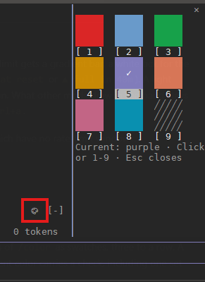
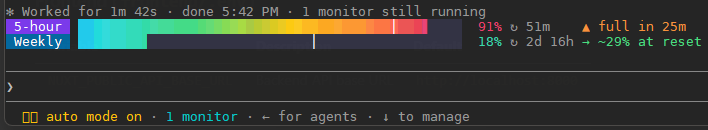
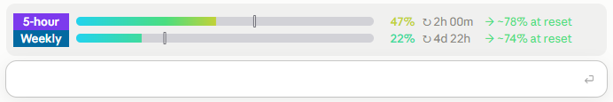
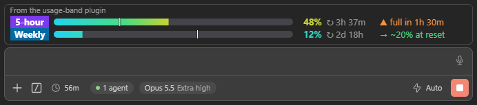

# claude-mods

Personal [Claude Code mods](https://code.claude.com/docs/en/plugins/mods/overview), packaged as a plugin marketplace.

Mods run in Claude Code: in the terminal, in the Desktop app's Code tab and in the VS Code extension, not in chat or Cowork. They need Claude Code 2.1.287 or later; the Desktop app brings its own copy, which needs 2.1.286 (`/status` in a Code tab session shows it), and the VS Code extension draws them from 2.1.299. They don't load in cloud sessions or in the Desktop app's WSL sessions.

## Install

There are two ways. If a computer has a mod both ways, Claude Code loads the command-line copy and leaves out the one from your account.

### In the Claude app

No command line needed. The mods are saved to your claude.ai account and load in every Claude Code session signed in to it, on any computer; sessions signed in with an API key or a token don't get them.

In the Desktop app, under **Customize** → **Plugins**, add `tiger42/claude-mods` as a marketplace from a repository, then add the mod and start a new Claude Code session. The app lists the marketplace as `claude-mods`; to see its mods, filter **Discover** by that **Source**. Updating, turning off and removing work from the mod's page there. [Anthropic's guide](https://claude.com/docs/plugins/overview) has the steps in detail.

### On the command line

The mods are installed on this computer only, for the terminal, the Desktop app and VS Code alike. This takes the Claude Code CLI: [install it](https://code.claude.com/docs/en/setup). On Windows, if the installer reports that `.local\bin` is not in your PATH, [add it](https://code.claude.com/docs/en/troubleshoot-install#verify-your-path) and open a new terminal.

```bash
claude plugin marketplace add tiger42/claude-mods
claude plugin install <mod>@tiger42    # for you, in every project
claude plugin disable <mod>@tiger42    # turn it off again
```

Add `--scope project` to the install to record the mod in the current repository's `.claude/settings.json`, so it's on for others working there once they install it too. Run `/reload-plugins` to load a mod into a terminal session that is already open.

To update, run `claude plugin marketplace update tiger42`, then `claude plugin update <mod>@tiger42`, and start a new session. Or let Claude Code do it: in `/plugin` in the terminal, go to **Marketplaces**, select `tiger42` and choose **Enable auto-update**.

## Mods

### color-chooser



A 🎨 button at the right end of the band above the prompt opens a picker with the session colors of `/color` as swatches, three to a row. A click on a swatch or its digit sets the color and closes the picker; Esc closes it unchanged. The current color carries a check, including one set with a typed `/color`. `/colors` opens the picker too, for when the band is collapsed.

While Claude is working, a color picked in the picker waits for the turn to end: Claude Code runs a mod's `/color` only once the session is idle, unlike a typed `/color`, which takes effect at once. Beside the 🎨 button the band says so (`● red once Claude is done`) until the color is set, a toast says it too, and in the picker its swatch carries `…`.

To skip the wait, check **Via prompt** in the picker (`p`; also under `/config` as the plugin's option). A color picked while Claude works then goes into the prompt as `/color <color>`, and Enter sets it at once; the band above the prompt (`● Press Enter to set red`) and the hint line under it say so. A draft you have typed is never replaced: with text in the prompt, the color waits for the turn as above. The last choice always stands: a `/color` typed while a pick waits is set again once the queue has run the pick.

The swatches are painted through the theme exactly as the prompt bar is, so they look the same in any color depth. With 256 colors or more the picker offers all eight colors and `default`. In 16 colors (`TERM=xterm` with no `COLORTERM`, typical over SSH) orange draws as red, blue as cyan and pink as purple, so it offers only red, green, yellow, purple, cyan and `default`; `COLORTERM=truecolor` brings the rest back if the terminal supports it. To switch it on, check that `printf '\e[38;2;217;119;87m██ orange\e[0m\n'` prints orange rather than red, then add `export COLORTERM=truecolor` to the shell profile (`~/.bashrc`) of the machine Claude Code runs on, the server when you connect over SSH, and start Claude Code anew. A session moved to the background (from the sessions overview) always runs in full color, whatever the terminal it was started from, so the picker there offers all eight.

Shares the band with other mods: the button sits beside whatever they draw there. Terminal only: the session color tints the terminal's prompt bar and nothing in the Desktop app, so the button and `/colors` stay out of other surfaces.

### usage-band

<br>
<sub>Terminal</sub>

<br>
<sub>Desktop app</sub>

<br>
<sub>VS Code extension</sub>

Band above the prompt showing the 5-hour and weekly rate limits of a Claude subscription. Each limit gets a gradient bar, a white tick for the time elapsed in the window, a countdown to the reset and a forecast at the current rate (`→ ~75% at reset` or `▲ full in 40m`). In the terminal a light sweeps the bars while Claude works. A new session starts from the last reading of any other session on the same machine. What other mods draw in the band stays beside the bars, or moves under them when there is no room. In the terminal, collapse the band with `ctrl+x ctrl+a`.

How to read it:

- **White tick:** how much of the window has already passed. If the bar ends left of it, you are using the limit more slowly than it allows; right of it, faster.
- **Forecast:** the pace so far, carried forward: used ÷ share of the window elapsed.

Draws in the terminal, in the Desktop app's Code tab and in the VS Code extension; outside the terminal the bars are drawn as SVG and grow with the window into the room beside the figures. Shows nothing for API-key accounts, which have no rate-limit windows.

## Development

```bash
claude --plugin-dir ./<mod>      # load a working copy, hot-reloads on save
claude plugin validate ./<mod>   # manifest and static analysis of the hooks module
claude plugin test ./<mod>       # runs <mod>/tests/*.test.ts(x)
```

`--plugin-dir` writes type declarations to `<mod>/.claude-plugin/types/` (git-ignored). Type-checking needs TypeScript 5.4 or later.

To add a mod, create its folder, list it under `plugins` in `.claude-plugin/marketplace.json` and add a section above.

An install from GitHub, through the app or on the command line, tells an update by the `version` in a mod's `.claude-plugin/plugin.json`, so raise it with every change to a mod. A change outside the mod folders, such as to this README, needs no bump.

### Use a local clone as the marketplace

```bash
git clone https://github.com/tiger42/claude-mods.git ~/claude-mods
claude plugin marketplace remove tiger42   # only if added from GitHub; uninstalls its mods
claude plugin marketplace add ~/claude-mods
```

A marketplace added from a local folder loads each mod in place, so an edit or a `git pull` takes effect at the next session or `/reload-plugins`, with no update step. It registers as `tiger42` too, so only one of the two can be added at a time. On Windows, run this in PowerShell with `$HOME\claude-mods` in place of `~/claude-mods`, and keep the clone on a local disk: Claude Code refuses a marketplace on a network drive.

## License

[MIT](LICENSE)
